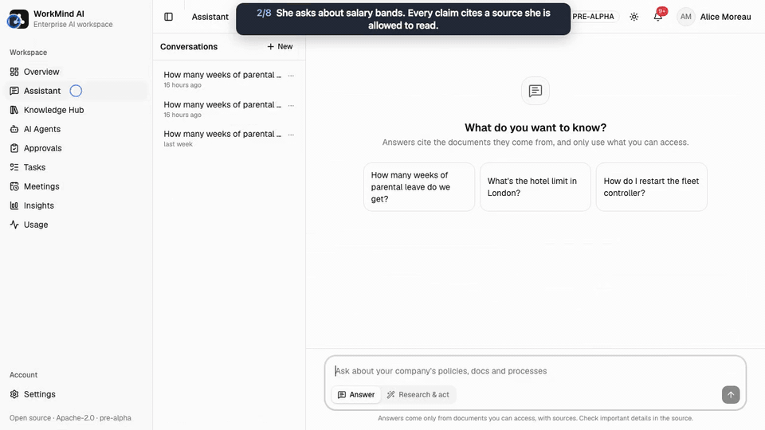
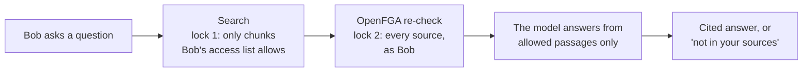
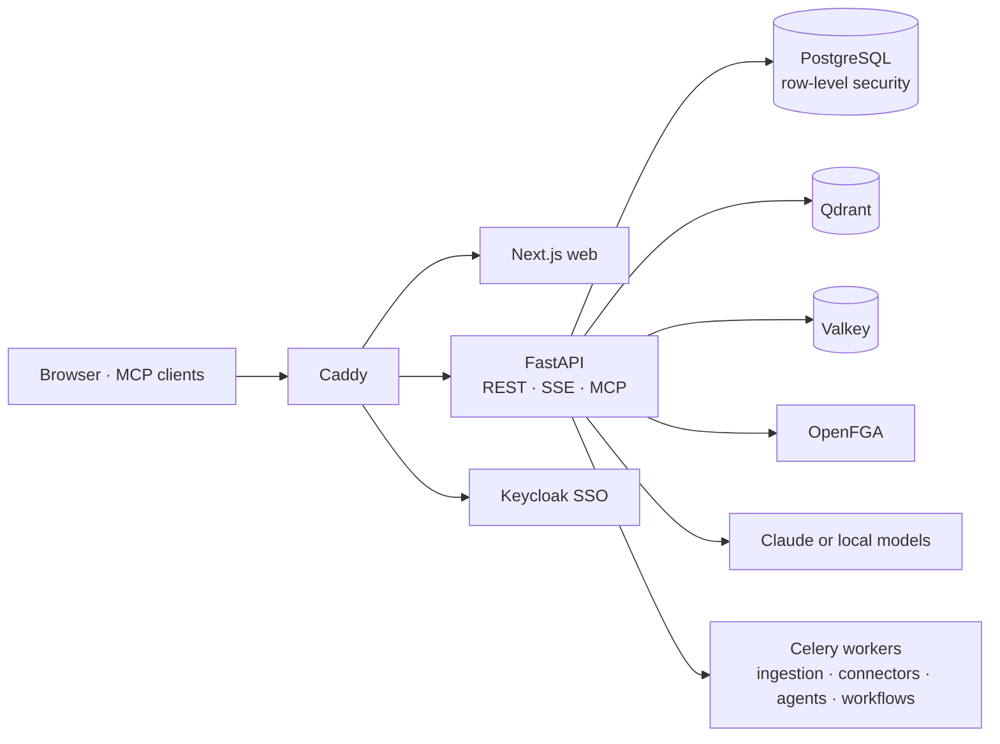

<div align="center">

<picture>
  <source media="(prefers-color-scheme: dark)" srcset="docs/media/logo-dark.svg">
  
</picture>

### Permission-Aware AI

**The open-source enterprise AI assistant that answers only from what each person is allowed to see, with a citation on every claim.**

[](LICENSE)
[](https://github.com/MatamDinesh0802/NeedWise/actions/workflows/ci.yml)
[](docs/benchmarks/v1.0.md)
[](docs/benchmarks/v1.0.md)
[](docs/models.md)

[Quick start](#quick-start) · [Features](#what-you-can-do) · [How permissions work](#how-permissions-work) · [Benchmarks](#benchmarks) · [Docs](docs/index.md)



<sub>Alice from HR gets the salary band, with a citation she can open. Bob from engineering asks the same question and is told his sources don't contain it.<br><a href="docs/media/demo.mp4">Watch the full 1:32 walkthrough</a>: agents, approvals, meetings, charts and admin.</sub>

</div>

## Why NeedWise

Most enterprise AI demos show one person asking one question. The hard part is what happens when someone else asks it.

| Principle | What it means |
|---|---|
| 🔒 **Permission-safe by construction** | Search returns only passages the person may open, and every source is checked again before the answer is written. The model never sees what the person can't. |
| 📎 **Cited or silent** | Every claim links to the passage it came from. When the documents don't have the answer, it says so. |
| 📏 **Measured, not claimed** | Each release publishes leak tests, answer quality, latency and cost. A single permission leak fails CI. |
| 🏠 **Yours to run** | Self-hosted with Docker Compose or Kubernetes. Use Claude, or run fully on local models, and keep restricted documents on a local model. |

## Quick start

You need Docker with Compose, `git` and `make`.

```bash
git clone https://github.com/MatamDinesh0802/NeedWise needwise && cd needwise   # the release: git checkout v1.0.0
cp .env.example .env    # add ANTHROPIC_API_KEY=sk-ant-..., or a local model (below)
make quickstart         # builds, starts and seeds the demo company: about 3 minutes
```

Open **http://localhost:8480**, sign in as `alice@acme.test` with the password `needwise-demo`, and ask *"What is the salary band for an L3 engineer?"* Then sign in as `bob@acme.test` and ask the same.

<details>
<summary><b>Models, ports and how long it takes</b></summary>
<br>

| Model | Lines in `.env` |
|---|---|
| Claude (the default) | `ANTHROPIC_API_KEY=sk-ant-...` |
| Fully local (Ollama, vLLM, llama.cpp) | `LLM_PROVIDER=openai_compatible`, `LLM_BASE_URL=http://host.docker.internal:11434/v1`, `LLM_MODEL=qwen3:14b` |

No key yet? `make quickstart` still works: search, the Knowledge Hub and the admin pages run, and the assistant says no language model is set up. Add a key later and run `make up`. Every model role can be set separately ([models](docs/models.md), [local models](docs/getting-started/local-models.md)).

These ports on `127.0.0.1` must be free: 8480, 8400, 3400, 8401, 5432, 6379, 6333 and 8025 ([to move one](docs/getting-started/configuration.md#ports-passwords-and-compose)).

| URL | What |
|---|---|
| http://localhost:8480 | The app: UI, API and login on one origin |
| http://localhost:8480/api/docs | Interactive API docs |
| http://localhost:8480/auth | Keycloak (admin console `admin` / `admin`, dev only) |
| http://localhost:8025 | Mailpit: every email the demo sends lands here |

**How long it takes**, measured from fresh clones on an Apple M5 laptop: every service healthy in about 2 minutes, the demo company seeded in about 3, a first cited answer in the browser in under 4 ([details](docs/getting-started/quickstart.md#how-long-it-takes)). The core stack needs about 3 GB of memory. On a Mac, `make embeddings` runs the embedding model on the Apple GPU.

`make status` shows component health, `make down` stops the stack and keeps the data, `make reset` deletes it, and `make` lists every command.

</details>

<details>
<summary><b>Demo logins and what to try</b></summary>
<br>

Every demo login uses the password `needwise-demo` (development only). **View as…** in the user menu switches between them.

| Sign in as | Who | Try |
|---|---|---|
| `alice@acme.test` | HR manager | *"What is the salary band for an L3 engineer?"* A cited answer from a restricted document |
| `bob@acme.test` | Software engineer | The same question: *"I couldn't find this in the sources available to you"*, with no hint the document exists |
| `olivia.grant@acme.test` | Head of operations | *"Prepare this week's operations report and email it to leadership@acme.test."* The email waits on an approval card; edit it, approve it, find it in Mailpit |
| `carol@acme.test` | Finance analyst | **Insights**: *"Monthly revenue trend this year and the top 3 drivers"*. A chart, the explanation and the SQL |
| `dan@acme.test` | Account executive | **Insights**: *"Show revenue by customer."* Dan only ever sees his own 13 customers, whatever SQL the model writes |
| `erin@acme.test` | IT administrator | **Admin**: add an agent and try it in its test console; models, budgets, the audit log |
| `mallory@acme.test` | External contractor | Sees one collection: the red-team user |

More to try:

- **Department agents.** Set `ASSISTANT_MODE=auto` in `.env`, run `make up`, and ask as Bob: *"For my on-call week: how do I restart the fleet controller, what P1 response time do customers get, and how close may I get to a moving AMR-500?"* Engineering, Support and Operations agents each answer their part.
- **Meetings.** As Olivia, upload `seed/acme/meetings/weekly-ops-sync-2026-11-02.m4a` in **Meetings**: local speech-to-text, then decisions and action items linked to the moment they were said.
- **Conflicting sources.** *"How many weeks of parental leave do we get?"* An older policy and a Slack thread disagree with the official 2026 policy; the answer prefers the official one and says so.

The demo company and every login: [seed/README.md](seed/README.md).

</details>

## What you can do

| Area | What you can do |
|---|---|
| 💬 **Ask** | Streaming answers over company documents, with clickable citations. Follow-ups are understood, and conflicting sources are flagged. [Guide](docs/user-guide/assistant.md) |
| 🧑‍💼 **Department agents** | HR, Finance, Engineering, Legal and more each answer their part of a cross-team question. Admins add agents in the UI, without code. [Agents](docs/agents.md) |
| ✅ **Act, with approval** | Emails and changes wait on an approval card. Approver rules and chains, reminders, escalation, request routing, and YAML workflows on schedules and events. [Automation](docs/automation.md) |
| 🎙️ **Meetings** | Local speech-to-text, speakers, topics, and decisions and action items linked to the second they were said. [Meetings](docs/meetings.md) |
| 📊 **Insights** | Questions about data answered with a chart, the SQL and checked numbers, always queried as the person asking. CSV, Excel, PostgreSQL and MySQL. [Analytics](docs/analytics.md) |
| 🔌 **Connectors** | Uploads, Google Drive, Slack, GitHub, Confluence, SharePoint/OneDrive and web pages. [Connectors](docs/connectors.md) |
| 🧩 **MCP** | Use NeedWise from Claude Code, Cursor or Claude Desktop, with permissions intact. [MCP](docs/mcp.md) |
| 🛡️ **Admin and governance** | SSO, departments and groups, models and budgets, usage, a hash-chained audit log, and document owners with review dates. [Governance](docs/governance.md) |

## How permissions work



Agents and tools always act as the person asking, never with more access. Each company's data is kept apart by PostgreSQL row-level security. More: [Architecture › Permissions](docs/ARCHITECTURE.md#7-permissions-authorization).

## Benchmarks

Measured on the fictional company Acme Robotics with Claude Sonnet 5.5: the v1.0.0 release check, and the full v1.0 benchmark for the suites the release check did not repeat. [Method, every report and the limits](docs/benchmarks/v1.0.md).

| | v1.0 |
|---|---|
| Permission leaks | **0** across all 68 attacks and 183 retrieval checks (and 0 in the full benchmark's 312 checks, 118 red-team and 51 analytics answers) |
| Answers with every required fact | 81 / 82 |
| Faithfulness / says "I don't know" when it should | 99.4% / 6 of 6 |
| Text-to-SQL execution accuracy | 33 / 36 |
| Time to first token, median | 0.9 s |
| Cost per answer | $0.007 |

How it was built, what went wrong and what it costs: the [case study](docs/case-study.md).

## Architecture



[Architecture](docs/ARCHITECTURE.md) · [Decision records](docs/adr/) · [Roadmap](docs/ROADMAP.md)

## Status

**v1.0.0** ([release notes](docs/releases/v1.0.0.md), [changelog](CHANGELOG.md)), built and tested end to end on a fictional company. Before you rely on it:

- It has not run on real company data.
- Drive, Slack, Confluence and SharePoint sync are tested against fakes of their APIs, not live workspaces.
- Kubernetes is tested on local kind clusters, not on a cloud.
- A few designed pieces aren't built yet: [the list](docs/ARCHITECTURE.md#what-the-design-describes-that-is-not-built).

<details>
<summary><b>Running it in production: what exists and what was checked</b></summary>
<br>

- **Kubernetes:** a Helm chart in [`deploy/helm/needwise`](deploy/helm/needwise), installed, upgraded and uninstalled on kind ([guide](docs/deploy/kubernetes.md)).
- **Backups:** `make backup` and `make restore`, with a restore drill ([backup and restore](docs/operations/backup-restore.md)).
- **Upgrades:** an upgrade test with rollback; upgrade testing starts at v1.0.0, the first release ([upgrades](docs/operations/upgrade.md)).
- **Several companies on one deployment:** isolation per layer, `nw tenant`, rate limits, and a test that sends every route another tenant's ids ([multi-tenancy](docs/multi-tenancy.md)).
- **Security:** a [threat model](docs/security/threat-model.md), an [OWASP LLM Top 10 review](docs/security/owasp-llm-top10.md), a red team of 68 attacks, and dependency, image and workflow scans with SBOMs ([SECURITY.md](SECURITY.md)).
- **Load:** up to 400 simulated users at unloaded chat latency on one laptop ([load benchmarks](docs/benchmarks/load.md)).

</details>

## Editions

- **Community:** everything outside `ee/`. Apache-2.0, security basics included.
- **Enterprise** (`ee/`, needs a license key): permission sync from source systems, legal holds, retention policies, department budgets and chargeback, and audit export for a SIEM. [Details](docs/enterprise.md)

## Documentation

| You want to | Read |
|---|---|
| Install and try it | [Quickstart](docs/getting-started/quickstart.md), [configuration](docs/getting-started/configuration.md), [local models](docs/getting-started/local-models.md) |
| Use it | [User guide](docs/user-guide/assistant.md) |
| Administer it | [People and roles](docs/user-guide/administration.md), [agents](docs/agents.md), [models](docs/models.md), [usage and budgets](docs/usage.md), [governance](docs/governance.md), [connectors](docs/connectors.md), [automation](docs/automation.md) |
| Run it for real | [Kubernetes](docs/deploy/kubernetes.md), [backup and restore](docs/operations/backup-restore.md), [upgrades](docs/operations/upgrade.md) |
| Understand it | [Architecture](docs/ARCHITECTURE.md), [decision records](docs/adr/), [roadmap](docs/ROADMAP.md), [evaluation](evals/README.md) |
| Know what changed | [v1.0.0 release notes](docs/releases/v1.0.0.md), [CHANGELOG](CHANGELOG.md) |

All of it also builds into a docs site: `make docs-serve`.

<details>
<summary><b>Local development and repository layout</b></summary>
<br>

Requirements: [uv](https://docs.astral.sh/uv/), Node.js 22+, [pnpm](https://pnpm.io) 10.

```bash
make install       # backend and frontend dependencies
make infra         # Postgres, Valkey, Qdrant, OpenFGA, Keycloak and Caddy in Docker
make api-dev       # the API on your machine, with auto-reload
make web-dev       # the UI on your machine, with hot reload
make lint test     # what CI runs
```

Open **http://localhost:8480** as usual: Caddy forwards to the processes on your machine. Stop the full stack (`make down`) before `make infra` so ports don't clash.

```text
apps/api      FastAPI backend (Python 3.13, uv)
apps/web      Next.js frontend (TypeScript, pnpm)
deploy/       Postgres init, Caddy, the Keycloak realm, the Helm chart
seed/         Acme Robotics: the fictional demo company and test corpus
evals/        Evaluation datasets, runners and published results
ee/           Enterprise Edition (separate license)
docs/         Guides, architecture, roadmap, ADRs, security, operations
e2e/browser   Browser end-to-end tests (Playwright) and the demo recorder
loadtests/    Load tests (Locust) and the stub model server
scripts/      Backup, restore, upgrade test, supply-chain scans
```

</details>

## Contributing and license

Contributions are welcome: see [CONTRIBUTING.md](CONTRIBUTING.md). Commits need a DCO sign-off (`git commit -s`). Report security issues privately: [SECURITY.md](SECURITY.md).

[Apache License 2.0](LICENSE), except the [`ee/`](ee/) directory, which has a separate commercial license. All demo data is fictional.

---

<sub>Built by <a href="https://github.com/MatamDinesh0802">Matam Dinesh Chandra</a> with Claude Code. NeedWise was called WorkMind until v1.0.0; older reports and commits use that name and the <code>wm</code> command.</sub>
