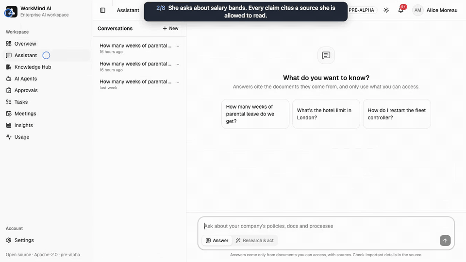

# Quickstart

This runs NeedWise on your machine with **Acme Robotics**, a fictional 180-person company with
departments, demo logins and 49 documents in 14 collections, some of them restricted and two with
their own access lists.



The [full walkthrough](../media/demo.mp4) (1 min 32 s) shows what the steps below lead to.

## Requirements

- Docker with the Compose plugin (the `docker compose` command), `git` and `make`. On macOS,
  Docker Desktop with about 8 GB of memory is enough: the core stack uses about 3 GB.
- Downloads on the first run: about 0.9 GB of service images (compressed; Postgres, Keycloak,
  Qdrant, the embedding server and the rest), the 330 MB embedding model, and the Python and
  Node packages the API and web images are built from.
- Free local ports 8480 (the app), 8400, 3400, 8401, 5432, 6379, 6333 and 8025. All of them
  bind to `127.0.0.1` only; [Configuration](configuration.md#ports-passwords-and-compose)
  shows how to move them.

## Start it

```bash
git clone https://github.com/MatamDinesh0802/NeedWise needwise && cd needwise
cp .env.example .env
```

Add a model to `.env` now if you have one ([below](#add-a-model-for-answers)): for Claude, the
line `ANTHROPIC_API_KEY=<your Anthropic API key>`. Then:

```bash
make quickstart
```

`make quickstart`:

1. copies `.env.example` to `.env` if there is no `.env` (it is git-ignored);
2. runs the embedding model (EmbeddingGemma-300M on llama.cpp) in a container, by adding
   `EMBEDDING_BASE_URL=http://embeddings:8080/v1` and `COMPOSE_PROFILES=embeddings` to `.env`;
3. builds and starts the stack and waits until every service is healthy;
4. creates the demo company (`make seed`): Keycloak logins, departments, groups, collections,
   agents, analytics data, and the documents, indexed through the real ingestion pipeline.

It ends by listing the demo logins. Open **http://localhost:8480**, sign in as `alice@acme.test`
with the password `needwise-demo`, and ask *"What is the salary band for an L3 engineer?"*

## How long it takes

Measured on 2026-11-13 by following this page from fresh clones of the repository, on an Apple
M5 laptop with Docker Desktop (8 CPUs, 16 GB). Seven other build-and-test jobs ran on the same
machine at the time (load average 12 to 14), so an idle machine is likely faster.

| Step | First run: empty build cache | Second run: build cache kept |
|---|---|---|
| `git clone` (a local clone) | 1 s | 1 s |
| Build the API and web images | 79 s | 12 s |
| Start until every service is healthy | 34 s (the embedding model downloads meanwhile) | 71 s (Keycloak's first start was the slowest) |
| **Every service healthy, from the clone** | **1 min 54 s** | **1 min 24 s** |
| Seed the demo company: 47 documents (364 chunks; the seed had 47 then, 49 since 2026-11-13) on CPU embeddings, analytics data, logins | 69 s | 76 s |
| **`make quickstart` done, from the clone** | **3 min 3 s** | **2 min 40 s** |
| Add the key to `.env`, then `make up` | 41 s | not needed: the key was in `.env` first |
| Sign in (page to signed in) | 1 to 2 s | 2 s |
| Ask until the answer shows its first citation | 2.4 s | 2.3 s |
| **First cited answer, adding up the steps** | **about 3 min 50 s** | **about 2 min 45 s** |

How it was run:

- **What was cached.** The service images (0.9 GB compressed for arm64) were already on the
  machine for both runs; a first run elsewhere also waits for them. The first run built the
  two images with a separate, empty BuildKit builder: its base images, packages and cache were
  all downloaded and built from nothing, and exporting the images from that builder into Docker
  took longer than Docker's own builder would. The second run used Docker's default builder
  with its cache. Each run started from empty volumes, so the embedding model downloaded each
  time.
- **What was changed.** Only what keeps a second stack apart from the one already running on
  that machine: another Compose project name, image tags and ports. The model key reached the
  containers through `.env`, as above.
- **What was not timed.** A person reading this page, typing and clicking: the answer rows add
  up the measured steps and leave out the pauses between them.
- **What went wrong.** The first attempt at the first run stopped after 18 seconds: `apk
  upgrade` in the web image could not resolve its package server (`DNS: transient error`). It
  was started again from nothing and went through; see [below](#if-something-goes-wrong).

## Demo logins

Every demo login uses the development password `needwise-demo` (the `DEMO_PASSWORD` setting).
These accounts exist only in a seeded development stack.

| Login | Who | Org role | Can read |
|---|---|---|---|
| `alice@acme.test` | Alice Moreau, HR manager | member | HR, employee records, payroll, company-wide documents |
| `bob@acme.test` | Bob Okafor, software engineer | member | Engineering, the support knowledge base, company-wide documents. **Not** salaries |
| `carol@acme.test` | Carol Lindqvist, finance analyst | member | Finance reports, company-wide documents. **Not** payroll |
| `dan@acme.test` | Dan Whitaker, account executive | member | Sales, company-wide documents |
| `erin@acme.test` | Erin Takahashi, IT administrator | admin | Runs the Admin pages. Being an admin does **not** grant restricted collections |
| `priya.raman@acme.test` | Priya Raman, CEO | owner | Leadership strategy, finance reports, company-wide documents |
| `hannah.schmidt@acme.test` | Hannah Schmidt, CFO | member | Finance reports, payroll, leadership strategy, company-wide documents |
| `olivia.grant@acme.test` | Olivia Grant, head of operations | member | Leadership strategy, finance reports, company-wide documents; edits the Operations SOPs |
| `mallory@acme.test` | Mallory Quinn, external contractor | guest | Only the contractor onboarding collection: the red-team user |

The source of truth is `seed/acme/company.yaml`. In the app, **View as…** in the user menu
signs in as another demo account. It is shown when `NEXT_PUBLIC_DEMO=1`, the default in
`compose.yaml`.

## Add a model for answers

Search, the Knowledge Hub and the admin pages work without a model. Answers, agents, meeting
notes and Insights need one; until there is one, a question ends with *"No language model is
set up yet"* and how to add one. Add one of these to `.env` (before `make quickstart`, or later
followed by `make up`):

| Option | Lines in `.env` |
|---|---|
| Claude (the default provider) | `ANTHROPIC_API_KEY=<your Anthropic API key>` |
| A model on your machine (Ollama, vLLM, llama.cpp, LM Studio) | `LLM_PROVIDER=openai_compatible`<br>`LLM_BASE_URL=http://host.docker.internal:11434/v1`<br>`LLM_MODEL=qwen3:14b` |

[Local models](local-models.md) covers the second option in detail. An organization can also
bring its own keys in the app, in **Admin › Models** ([Models and keys](../models.md)).

## Try it

Ask the same question as two people, and compare:

1. Sign in as `alice@acme.test` and ask *"What is the salary band for an L3 engineer?"* The
   answer cites the salary bands in Employee Records; click a citation to open the source.
2. Sign in as `bob@acme.test` (or use **View as…**) and ask the same. Bob gets *"I couldn't find
   this in the sources available to you"*, with no hint that the document exists.

More to try:

- *"How many weeks of parental leave do we get?"*: an older policy and a Slack thread disagree
  with the official 2026 policy. Answers prefer the official source and mention the
  disagreement.
- **Research & act** (as `olivia.grant@acme.test`): *"Prepare this week's operations report and
  email it to leadership@acme.test."* The drafted email waits on an approval card: edit it,
  approve it, and read it in Mailpit (http://localhost:8025).
- **Department agents**: set `ASSISTANT_MODE=auto` in `.env` and run `make up`. Then, as Bob:
  *"For my on-call week: how do I restart the fleet controller, what P1 response time do
  customers get, and how close may I get to a moving AMR-500?"* Three department agents answer
  their parts.
- **Knowledge Hub**: open a collection you can edit (Alice: Company Handbook) and upload a file;
  watch it get indexed and see its chunks.
- **Meetings** (as `olivia.grant@acme.test`): upload
  `seed/acme/meetings/weekly-ops-sync-2026-11-02.m4a` (or the `.txt` transcript) to Operations
  SOPs. Its decisions and action items link to the moment they were said.
- **Insights** (as `dan@acme.test`): *"Show revenue by customer."* Dan only ever sees his own
  13 customers, whatever SQL the model writes; Carol sees all of them.
- **Admin** (as `erin@acme.test`): agents, models, budgets, the audit log.

## Where things are

| URL | What |
|---|---|
| http://localhost:8480 | The app: UI, API and login on one origin, through Caddy |
| http://localhost:8480/api/docs | Interactive API docs (not served when `APP_ENV=production`) |
| http://localhost:8480/auth | Keycloak (its admin console uses `KEYCLOAK_ADMIN_USER` / `KEYCLOAK_ADMIN_PASSWORD`, development values in `.env.example`) |
| http://localhost:8025 | Mailpit: every email NeedWise sends in development lands here, none is delivered |

## Everyday commands

| Command | What it does |
|---|---|
| `make up` | Build and start the stack (after changing `.env`) |
| `make status` | Component health as the API reports it |
| `make logs s=api` | Follow one service's logs |
| `make down` | Stop the stack; data is kept |
| `make reset` | Stop the stack and **delete all local data** |
| `make ee-dev-license` | Turn on the Enterprise features with a development license ([Enterprise edition](../enterprise.md)) |
| `make` | List every command |

## Develop on your machine

Requirements: [uv](https://docs.astral.sh/uv/), Node.js 22 or later, pnpm 10.

```bash
make install    # backend and frontend dependencies
make infra      # Postgres, Valkey, Qdrant, OpenFGA, Keycloak and Caddy in Docker
make api-dev    # the API on the host, with auto-reload
make web-dev    # the UI on the host, with hot reload
make lint test  # what CI runs
```

http://localhost:8480 still serves everything: Caddy forwards `/api` and the UI to the processes
on your machine, so sign-in and cookies behave as in Docker. Stop the full stack (`make down`)
before `make infra` so the ports don't clash.

## If something goes wrong

- **A port is taken.** Each one has a setting in `.env`: `HTTP_PORT` (with `PUBLIC_URL` to
  match), `API_PORT`, `WEB_PORT`, `POSTGRES_PORT`, `VALKEY_PORT`, `QDRANT_PORT`,
  `OPENFGA_PORT` and `MAILPIT_PORT`. Change it, then `make up`. `make up` and `make status`
  read `HTTP_PORT` from `.env` too.
- **The build stops with a network error**, such as `DNS: transient error` from `apk` or a
  timeout from `apt-get` or `uv`. Run `make quickstart` again: the steps that finished are
  cached. It happened once while this page was being measured.
- **Seeding or uploads fail with `Permission denied: '/data/objects/...'` (Linux).** The
  containers run as uid 10001, and a Linux Docker daemon creates a missing bind-mount directory
  as root. `make up` and `make quickstart` run `make objects-dir`, which creates `.data/objects`
  and gives it to uid 10001; run it yourself before a plain `docker compose up`. Docker Desktop
  ignores ownership, so macOS and Windows never see this.
- **The stack is slow on a Mac.** Run the embedding model on the Apple GPU instead of in Docker:
  `make embeddings` (needs llama.cpp on the host) and
  `EMBEDDING_BASE_URL=http://host.docker.internal:8091/v1` in `.env`. Both produce the same
  vectors, so nothing needs re-indexing.
- **An answer says "No language model is set up yet".** See
  [Add a model for answers](#add-a-model-for-answers); after changing `.env`, run `make up`.
- **Anything else:** `make status` names the component that is down; `make logs s=<service>`
  shows why.
