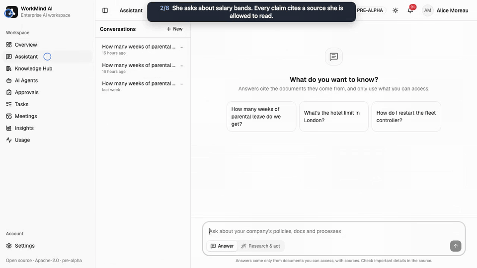

# NeedWise

NeedWise is an open-source AI workspace for companies that you run on your own servers.
Employees ask questions in plain language and get answers from company documents, with a
citation for every claim, drawn only from sources they are allowed to read. Department agents,
meeting notes, questions about company data and approved actions build on the same
permission checks.

> NeedWise was called WorkMind until v1.0.0; older reports and commits use that name and the `wm` command.



The [full walkthrough](media/demo.mp4) (1 min 32 s): cited answers, the same question without
access, department agents, an approval, a meeting, a chart with its SQL, and an administrator
adding an agent.

!!! info "Status: v1.0.0, released on 2026-11-13"
    All 13 phases of the [roadmap](ROADMAP.md) are built ([release notes](releases/v1.0.0.md),
    [GitHub Release](https://github.com/MatamDinesh0802/NeedWise/releases/tag/v1.0.0)). Images: `ghcr.io/matamdinesh0802/needwise-api:1.0.0` and `ghcr.io/matamdinesh0802/needwise-web:1.0.0`
    (linux/amd64 and linux/arm64).
    NeedWise has been run only on the fictional demo company: try it there, or on test data,
    before anything real.

## Who it is for

- **Teams and companies** that want an assistant over their own documents, where an engineer
  cannot read salaries through the assistant just because the assistant can.
- **IT and platform teams** who must keep data on their own infrastructure: NeedWise runs with
  Docker Compose, and every model can be local.
- **Developers** who want a permission-aware knowledge source inside Claude Code, Cursor or
  Claude Desktop, over MCP.

## What it does

| Capability | In short |
|---|---|
| **Cited answers** | Streaming answers from the documents you may read, each claim marked with its source; "I couldn't find this" when the sources don't say. [Assistant](user-guide/assistant.md) |
| **Permissions in code** | Search filters every passage by its access list, then re-checks each source with OpenFGA. The model only sees what the asking person may read. [Two locks](adr/0006-two-lock-permission-aware-retrieval.md) |
| **Knowledge Hub** | Upload PDF, Word, Excel, PowerPoint, Markdown, HTML, CSV or Slack exports, or sync a website, GitHub, Slack or Google Drive. [Knowledge](user-guide/knowledge.md), [Connectors](connectors.md) |
| **Agents as configuration** | Department agents an administrator adds in the browser, with a test console and versions. [Agents](agents.md) |
| **Insights** | Questions about company tables answered with a chart, the SQL and checked numbers, under row-level policies. [Insights](analytics.md) |
| **Meetings** | A recording or transcript becomes decisions and action items that link to the moment they were said. [Meetings](meetings.md) |
| **Approvals** | Anything that changes something outside NeedWise waits for a person to approve it. [Approvals and tasks](user-guide/approvals-and-tasks.md) |
| **Your models** | Claude by default, or any OpenAI-compatible server, per organization and per role; restricted documents can be kept on a local model. [Models](models.md), [Local models](getting-started/local-models.md) |
| **Measured** | `nw eval` asks the same questions as different employees and must find zero permission leaks; v1.0.0 release check: 0 leaks in 68 attacks on four surfaces, 81/82 answers correct, $0.007 per answer. [v1.0 benchmarks](benchmarks/v1.0.md), [Evaluation](evals/README.md) |

## Quickstart

Requirements: Docker with the Compose plugin, `git` and `make`.

```bash
git clone https://github.com/MatamDinesh0802/NeedWise needwise && cd needwise
cp .env.example .env    # then add a model, e.g. ANTHROPIC_API_KEY=sk-ant-...
make quickstart
```

Then open http://localhost:8480 and sign in as `alice@acme.test` (password `needwise-demo`).
Measured from fresh clones on a busy laptop, with the service images already downloaded: every
service was healthy after 1 to 2 minutes, the demo company was seeded after about 3 minutes, and
the first cited answer came under 4 minutes after the clone. Search works without a model;
answers need one.
[Quickstart](getting-started/quickstart.md) has the measurements, the demo logins and the next
steps.

## Where to read next

| You want to | Read |
|---|---|
| Try it on the demo company | [Quickstart](getting-started/quickstart.md) |
| Use the assistant, upload documents, approve actions | [User guide](user-guide/assistant.md) |
| Add agents, models, budgets, connectors | [Admin guide](agents.md) |
| Configure a deployment | [Configuration](getting-started/configuration.md) and the [reference](reference/configuration.md) |
| Call the API | [HTTP API](reference/api.md) |
| Run it on Kubernetes, back it up, upgrade it | [Kubernetes (Helm)](deploy/kubernetes.md), [backup and restore](operations/backup-restore.md), [upgrades](operations/upgrade.md), [multi-tenant mode](multi-tenancy.md) |
| Check how it is secured | [Threat model](security/threat-model.md), [OWASP Top 10 for LLM Applications review](security/owasp-llm-top10.md), [supply chain](security/supply-chain.md) |
| Understand the design | [Architecture](ARCHITECTURE.md) and the [decision records](adr/README.md) |
| See what was measured | [v1.0 benchmarks](benchmarks/v1.0.md), [evaluation](evals/README.md), [load benchmarks](benchmarks/load.md) and the [case study](case-study.md) |
| Know what changed | the [v1.0.0 release notes](releases/v1.0.0.md) and the [changelog](../CHANGELOG.md) |
| See what comes next | [Roadmap](ROADMAP.md) |

## License

The core is under the Apache License 2.0. The `ee/` directory (Enterprise features, which need
a license key) is under a separate commercial license: [Enterprise edition](enterprise.md). All
demo data is fictional.
