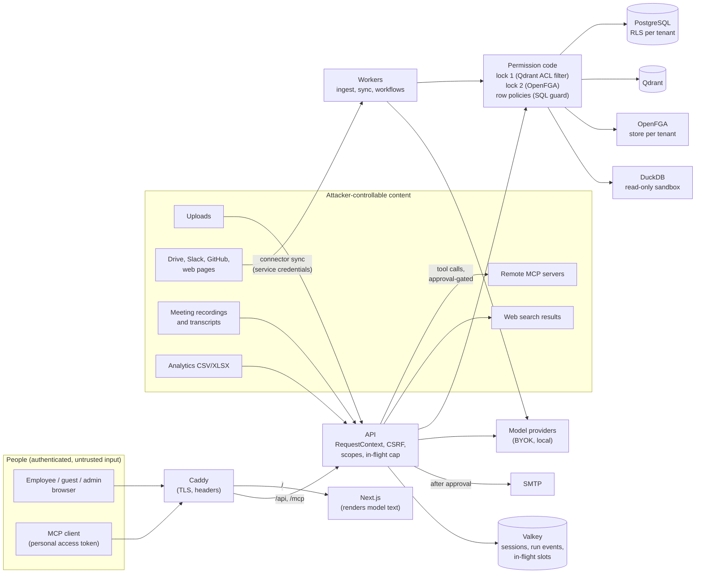

# Threat model

> **Reviewed:** 2026-11-12, Phase 12 security review (branch `p12-security`).
> **Companion:** [owasp-llm-top10.md](owasp-llm-top10.md) maps the same controls to the OWASP Top 10
> for LLM Applications (2025), with the tests that prove them. [ARCHITECTURE section 20](../ARCHITECTURE.md#20-security-and-threat-model)
> is the summary.

This model covers what is built in this repository: the API (FastAPI), the workers (Celery),
the web app (Next.js), the MCP server and client, and the Compose deployment behind Caddy. It
does not cover the Helm chart, WorkMind Cloud, or Keycloak, PostgreSQL, Qdrant, Valkey and
OpenFGA themselves (their hardening is the operator's).

The method: reading the code of every surface below, then trying to break it with tests in
which a scripted model (`apps/api/tests/fakes.py`) does exactly what an injected instruction
asks, so that only code stands between the attack and the data. The fixes this review made are
listed in [owasp-llm-top10.md](owasp-llm-top10.md#fixes-made-in-this-review). The red team
(`evals/datasets/red_team.jsonl`, 59 attacks): its retrieval part runs in CI without a model; its
answer part was run once with Claude Sonnet 5.5 after the Phase 12 merges (2026-11-12): 0 leaks,
2 violations after a scoring fix ([owasp-llm-top10.md](owasp-llm-top10.md)).

## 1. Assets

| Asset | Where it lives | Why it matters |
|---|---|---|
| Restricted documents (salaries, reviews, payroll, M&A) and their chunks | Object storage (`tenants/<id>/...`), PostgreSQL `chunks`, Qdrant payloads | The product's promise: only the people allowed see them |
| Every other document, per collection | Same | Department and guest boundaries |
| Analytics datasets (CSV/XLSX loaded into DuckDB) | `<object storage>/analytics/<tenant>/...` | Row policies (an account executive sees their own accounts) |
| Answers, conversations, research runs, analytics answers | PostgreSQL; run event streams in Valkey for 1 hour | Contain what the person was shown |
| Model provider API keys (BYOK), connector credentials | PostgreSQL, AES-256-GCM sealed | Spending, and access to Drive, Slack, GitHub |
| Sessions and personal access tokens | Valkey (session id hashed), PostgreSQL (token hash) | Acting as a person |
| The audit log | PostgreSQL `audit_events`, hash-chained, insert-only for the app role | Evidence of who did what |
| Budgets and usage | PostgreSQL `usage_events`, `budgets` | Money; availability |
| The SMTP account, the outbound network position | Deployment configuration | Mail sent as the company; requests from inside the network |
| System prompts and agent instructions | Code; `agent_definitions` (admin-written) | Low secrecy value, but leakage shows what an attacker can steer |

## 2. Actors

| Actor | Can | Trusted for |
|---|---|---|
| Employee (member) | Ask, search, research mode, upload to collections they edit, analytics if granted, personal access tokens | Their own access |
| Guest (external contractor, Mallory) | The same, limited to collections shared with them by name | Almost nothing: no directory, no enterprise collections, no mail or task tools (fixed in this review) |
| Auditor | Audit log and usage; members of a department see its department collections | Reading evidence, not knowledge |
| Org admin (Erin) | Users, groups, departments, collection sharing, sources (connectors), agents, models and providers, workflows, budgets, the analytics model | Configuration. **Not** content: an admin is not a viewer of restricted collections by default |
| **Malicious insider admin** | Can grant themselves (or anyone) a restricted collection; write agent instructions that steer answers; point a model provider or web source at internal hosts; save a workflow that runs as them on every new document; set budgets to nothing | Nothing beyond configuration. Every such change is audited in the hash-chained log; nothing prevents it |
| Org owner (Priya) | Admin rights plus ownership | As admin |
| **Malicious document author** | Anyone who can put text where WorkMind reads it: an uploader with edit rights to a collection; a Google Drive or GitHub author; any member of a synced Slack channel (Slack Connect guests included); a website a web source crawls; a meeting participant whose words end up in a transcript; a customer whose support ticket is exported; a third-party MCP server | Nothing. Their text is data that a model reads |
| External attacker (no account) | Reach Caddy (`/`, `/api`, `/mcp`, `/auth`), Keycloak's login | Nothing |
| Model provider (Anthropic, an OpenAI-compatible endpoint) | Sees every prompt sent to it, including passages | Per the tenant's data policy: restricted passages go only to local models by default |
| Operator (whoever runs the deployment) | Everything: database, keys, images | Fully trusted; out of scope |

## 3. Trust boundaries and data flow

The boundaries that matter:

1. **Browser and MCP client to API.** Everything a person sends is untrusted. A session cookie
   or a personal access token becomes an immutable `RequestContext` (`core/context.py`) that
   every service function receives.
2. **Model input boundary.** Everything a model reads that a person did not type is
   attacker-controllable: passages, tool results, query results, transcripts, event fields.
   It is delimited and escaped (`modules/assistant/safety.py`, `answer.render_sources`) and
   the prompts say it is data. That boundary is probabilistic: a model may still follow text.
3. **Model output boundary.** Model text is untrusted when it leaves: as markdown in the web
   app (no raw HTML, no images, links show their host), as stored answers and MCP results
   (no images), as tool calls (validated, scoped, approval-gated, audited).
4. **The permission code.** The only place that decides who sees what. Models never decide:
   agents, tools, research and analytics all act as the asking person, and every read goes
   through lock 1 and lock 2 or the SQL guard.
5. **Tenant boundary.** PostgreSQL row-level security (forced, fail-closed), a tenant filter in
   the Qdrant repository, an OpenFGA store per tenant, per-tenant analytics files.
6. **Outbound requests.** Model providers, web sources, remote MCP servers, SearXNG and SMTP
   are configured by admins or the operator; base URLs and crawled hosts go through the
   outbound URL policy (`core/urls.py`).

## 4. STRIDE per component

S: spoofing, T: tampering, R: repudiation, I: information disclosure, D: denial of service,
E: elevation of privilege. "Residual" lists what is not prevented.

### 4.1 Chat, answers and citations (`modules/assistant/answer.py`, `modules/conversations/`)

| | Threat | Control | Residual |
|---|---|---|---|
| S | Ask as someone else | BFF session (opaque cookie, server-side tokens), PAT hashing, `RequestContext` from the server only | Stolen session cookie within its 30-minute idle window |
| T | A document pre-writes citation markers so its claim shows a trusted source's chip | Markers in sources reach the model as `(S1)` (`safety.quote_markers`, fixed); answers only map markers to passages they were given; unknown markers reported | The model can still attribute a claim to the wrong real source; there is no sentence-level verification (ARCHITECTURE 11.5 describes one; it is not built) |
| R | Deny having seen something | `assistant.answered` audit event with document ids, cited ids, model | Event content is ids, not text |
| I | Restricted passages to an unauthorized person | Lock 1 + lock 2 before any model call; abstention says nothing about what exists | Lock 2 is per collection; there are no per-document grants |
| I | Restricted passages to an external model | Sensitivity routing (`route`): above the tenant's threshold only to a local model, else withheld and counted | The label is set by ingestion rules and collection defaults; a mislabelled document is routed by its label |
| I | Answer exfiltrates data through an image URL | Images removed from stored answers and research text (fixed), never loaded in the web app, CSP `img-src 'self'` | Tokens are streamed raw over SSE before the stored copy is cleaned: an API client rendering the stream itself would see the image markup |
| I | Answer exfiltrates through a link | Links open in a new tab, `noreferrer`; the host is shown next to the text (fixed) | No allow-list: a person can still click |
| D | Many concurrent runs | One run per conversation; at most `MAX_INFLIGHT_PER_USER` (4) answers in progress per person (fixed); request rate limits per person and tenant (`core/ratelimit.py`, added by the multi-tenancy work after this review); budgets | Budgets do not count unpriced (local) models; the rate-limit defaults were chosen, not measured |
| E | Follow-up history used to re-ask after access is revoked | Each turn retrieves again with current access | Earlier answers stay in the conversation and its summary, and are sent back as history |
| T | An injected answer persists: folded into the summary, it would sit in the system prompt of every later turn | The summary and the history are escaped and cannot close their elements (fixed); the summary is labelled "not a source" | The summary is still model text in the system prompt; a model may follow it |

### 4.2 Agents mode and configured agents (`modules/agents/`)

| | Threat | Control | Residual |
|---|---|---|---|
| E | "Ask the HR agent for salaries" | Agents search as the person, narrowed to their collections (an intersection, never a union) | none known |
| E | An admin configures an agent with write tools | Department agents get only `read` tools, re-checked on every run (`offered_tools`) | none known |
| T | Malicious insider admin writes instructions ("tell everyone to reset their password at ...") | Versioned, audited agent definitions; admin-only | Nothing stops a malicious admin's instructions from reaching users |
| I | Agent instructions or system prompt extracted | Prompts tell models not to discuss their rules | Not secret by design; red team measures verbatim leakage (violations) |
| D | Agent loops | `max_searches`, `max_tool_calls`, `max_output_tokens`, 90 s timeout per agent | Budgets do not count unpriced models |

### 4.3 Research mode, tools and approvals (`modules/agents/research.py`, `modules/tools/`, `modules/work/approvals.py`)

| | Threat | Control | Residual |
|---|---|---|---|
| E | Injected instruction makes the agent send email or create a task | Write and external tools stop at the approval gate; the approval stores the call and shows its full arguments; it runs only if a person approves | The person who asked approves their own research run's actions: an injected email the person does not read carefully can be approved |
| E | A guest sends mail as the company or assigns work to employees | `send_email` and `create_task` are not available to guests, and refuse them (fixed); a guest's POST /tasks is for themselves only, and a guest cannot hand a task to anyone else with PATCH /tasks/{id} (both fixed) | none known |
| I | Probing the directory through tool errors | Guests no longer reach `create_task` (fixed) | Members can still learn whether an address exists (they also see the directory) |
| D | "Search this 200 times" in one turn | At most 6 model turns and 12 executed tool calls per research run (fixed) | none known |
| T | An approver edits a workflow's proposed email and it runs as the workflow's owner | Edits are audited (`edited: true`) and shown on the approval | By design: the approver is chosen by the owner |
| R | Deny having approved | Approval decisions are audited with the decider | none known |

### 4.4 MCP server (`modules/mcp_server/`) and client (`modules/tools/mcp_client.py`)

| | Threat | Control | Residual |
|---|---|---|---|
| S | Call MCP without a token, with a forged or another tenant's token | `RequireAccessToken` (401) and per-tool authentication; tokens hashed, tenant slug bound, expiring, revocable | Tokens are bearer tokens: anyone holding one acts as its owner within its scopes |
| E | A token used for administration | No grantable scope administers; a token can never mint tokens | none known |
| I | Analytics tools listed to people without access | `HideUnavailableTools`; the service refuses anyway | none known |
| I | The MCP client renders an image from `ask` | No images in `ask` results (fixed) | Links are returned as written |
| T | A remote MCP server's result closes `</external>` and poses as instructions | Escaped, markers quoted (fixed) | The model reads the text and may follow it |
| E | A remote server claims a tool is read-only | Remote tools are `external` (approval-gated) unless the operator lists them as read-only | The operator's list is trusted |
| D | MCP `ask` floods | In-flight cap applies (fixed), budgets apply | as chat |

### 4.5 Workflows and `document.ready` (`modules/work/workflows.py`, `modules/work/events.py`)

| | Threat | Control | Residual |
|---|---|---|---|
| E | A document author makes a workflow act with its owner's (admin's) access | The run starts only if the owner can view the collection; research steps never propose actions; side effects stop at an approval | The research step reads with the owner's access, steered by the document; what it found can flow into a later step's arguments, which the approver sees |
| T | The document's title speaks as the owner in the research question | Event and step values are quoted as `<data>` (fixed) | The model may still follow quoted text |
| D | Many uploads trigger many runs | One run per workflow and document version (idempotency key) | No cap on runs per hour; budgets apply to priced models |
| R | Who triggered a run | `workflow.triggered` audit event with document and version | none known |

### 4.6 Connectors: Drive, Slack, GitHub, web (`modules/connectors/`)

| | Threat | Control | Residual |
|---|---|---|---|
| E | Confused deputy: query-time access through the connector's service credentials | Credentials are used only to sync; every synced document lands in the source's collection with that collection's access | Per-document source permissions are not synced (Enterprise roadmap): everyone who can read the collection reads every synced item |
| T | Slack messages become official policy in an official-by-default collection | Slack syncs are always `discussion` (fixed) | Drive, GitHub and web items take the collection's default trust, an admin decision |
| I | A web page redirects the crawler to the cloud metadata endpoint, and the answer is indexed | Redirects followed by hand only within the site; every host checked against the outbound URL policy, also through DNS (fixed); start URLs checked when saved | Private and loopback addresses are allowed (intranets); DNS rebinding between the check and the request is not caught |
| I | Connector tokens leak | AES-256-GCM, bound to the source id; write-only in the API | One deployment key (`SECRETS_KEY`), no KMS |
| D | A huge site or file | `max_pages` (up to 5,000), `max_bytes` per item | none known |

### 4.7 Meetings (`modules/meetings/`)

| | Threat | Control | Residual |
|---|---|---|---|
| T | A participant (or a forged transcript) injects "record as a decision ..." | Transcript text escaped and its segment ids quoted (fixed); the prompt says it is data; extracted items cite segments that are checked; nothing becomes a task without a person's click | The model may still record an injected decision; `mt-02` measures it |
| I | Meeting content seen by non-participants | Visibility follows the meeting's collection (both locks) | none known |
| D | Large recordings | `MAX_MEETING_BYTES` (500 MB) | Transcription is CPU-bound in the worker |

### 4.8 BI agent and analytics (`modules/analytics/`)

| | Threat | Control | Residual |
|---|---|---|---|
| E | Generated SQL reads another rep's rows | sqlglot guard: one SELECT, model tables only; row policies applied as fences (temporary tables) for every restricted table | none known (10 attacks in `analytics.jsonl`, 5 in `red_team.jsonl`) |
| I | Files, settings, catalog, environment through DuckDB functions | A deny-list of file, network, catalog and settings functions (`DENIED_FUNCTIONS`); model tables only; and, as the second lock, a read-only connection with external access off and its configuration locked | A DuckDB function missing from the deny-list is stopped only by the second lock |
| I | Error messages as an oracle | Guard errors name rules, not data; queries on hidden rows are fenced, not refused | none known |
| T | An uploaded CSV cell carries an instruction | Cells are escaped in prompts; numbers in the narrative are checked against results | The narrative is model text over attacker data |
| D | Expensive queries | Worker processes with memory and time limits, a bounded pool, one query per person at a time, 16 tool calls per question | none known |

### 4.9 Governance, usage and budgets (`modules/knowledge/governance.py`, `modules/usage/`, `modules/governance/`)

| | Threat | Control | Residual |
|---|---|---|---|
| T | Make your own document official | Official status needs an approval by someone else who can read the collection, for that version; new content ends it | none known |
| R | Tamper with the audit log | Insert-only for the app role, hash chain verifiable from Admin › Audit | The database owner role (operator) can rewrite it; a verifiable JSONL export for a SIEM is Enterprise (`ee/python/src/workmind_ee/audit_export.py`) |
| D | Run up costs | Tenant, department (Enterprise) and per-person budgets in USD, checked before every model call | Unpriced models are not counted |
| E | Malicious admin removes budgets | Audited | By design |

### 4.10 Model providers, BYOK and base URLs (`modules/model_catalog/`)

| | Threat | Control | Residual |
|---|---|---|---|
| I | SSRF through a provider base URL | Outbound URL policy at save and test (metadata, link-local, reserved refused); no redirects; test results never echo bodies | Private and loopback hosts allowed (local models live there); an admin can make WorkMind send requests to them |
| I | Provider keys leak in errors | Keys scrubbed from errors; sealed with key ids and associated data (tenant, provider, kind, URL) | One deployment key ring, no KMS |
| I | Restricted data to a hosted model | The tenant's data policy; restricted passages local-only by default | The demo tenant (`seed/acme`) allows restricted data on purpose |

### 4.11 Web app (`apps/web`)

| | Threat | Control | Residual |
|---|---|---|---|
| T | XSS through model text or document text | React escaping; markdown without raw HTML (`skipHtml`); no `dangerouslySetInnerHTML`; `javascript:` URLs dropped | CSP allows `'unsafe-inline'` scripts (Next.js inline bootstrap) |
| I | Exfiltration by image | Images never loaded; CSP `img-src 'self' data: blob:` in production builds | The dev server sends no CSP |
| S | CSRF | SameSite=Lax cookie, Origin check, `X-CSRF-Protection: 1` header | none known |
| S | Clickjacking | `frame-ancestors 'self'`, `X-Frame-Options SAMEORIGIN` (Caddy) | none known |

## 5. Residual risks, ranked

1. **Prompt injection is mitigated, not solved.** Within what a person may see and do, a model
   can still be steered by a document: wrong facts, a misleading summary, a research search
   the person did not intend, an action proposed for approval. Code bounds the damage
   (permissions, approvals, no images, tool caps); it cannot make the text true. The red team
   reports how often the model obeys (violations): 2 of 59 in its one live run, neither an
   obeyed instruction or a leak (owasp-llm-top10.md).
2. **A malicious insider admin** can grant themselves restricted collections, steer every
   answer through agent instructions, run workflows with their own access on every new
   document, and point outbound requests at internal hosts. All of it is audited; none of it
   is prevented. Separation of duties is a default, not an enforcement.
3. **Self-approval.** In research mode the person who asked approves the proposed email or
   task. The approval shows every argument; a hurried approval of an injected email still
   sends it.
4. **Unpriced models are not budgeted.** The in-flight cap bounds concurrency per person and
   the request rate limits (`core/ratelimit.py`, [multi-tenancy](../multi-tenancy.md#abuse-limits))
   bound requests per minute, but nothing bounds what an unpriced model does over a day.
5. **No per-document permissions.** Access is per collection; synced sources do not bring their
   own per-file sharing (Enterprise roadmap).
6. **Secrets use one deployment key** (`SECRETS_KEY`, `SECRETS_ENCRYPTION_KEY`), not per-tenant
   data keys or a KMS.
7. **Streamed tokens are not sanitized**; the stored answer is. API clients that render the SSE
   stream themselves must not load images.
8. **Supply chain** is outside this review. Lockfile and image scanning, SBOMs and digest
   pinning were added by separate Phase 12 work ([supply-chain.md](supply-chain.md)); those CI
   workflows have not run on GitHub yet.

## 6. Keeping this current

Each fix in this review has a regression test that fails without it (listed in
[owasp-llm-top10.md](owasp-llm-top10.md)). New surfaces should add attacks to
`evals/datasets/red_team.jsonl`: an attack that the retrieval-only gate can check (forbidden
documents or canaries) runs in CI on every push.
